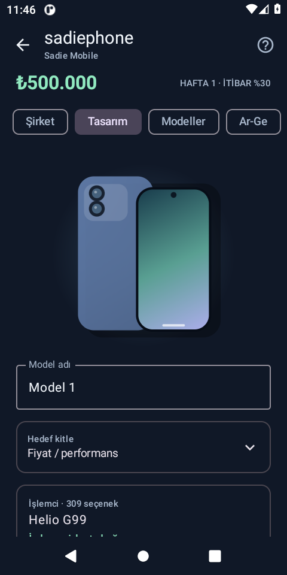

# sadiephone

Kendi telefon şirketini kurduğun bağımsız Android yönetim oyunu. **Türkçe · Android 8.0+ · Çevrimdışı · Otomatik kayıt**

[**APK’yi indir — v1.0.0**](https://github.com/nightmare608/sadiephone/releases/download/v1.0.0/sadiephone.apk) · [Sürümler](https://github.com/nightmare608/sadiephone/releases)



## Oynanış

₺500.000 oyun sermayesiyle şirketini kur. Telefonunu tasarla, küçük bir parti üret,
fiyatını belirle ve haftayı ilerleterek satışlarını gör.

- 309 işlemci ismi; üretici filtreli ve aranabilir katalog.
- RAM, depolama, ekran, kamera, pil, kasa, soğutma, renk ve güncelleme desteği.
- Fiyat/performans, oyuncu, fotoğrafçı ve premium hedef kitleleri.
- Etkileşimli telefon çizimi, parça maliyeti ve prototip puanları.
- Model lansmanı, ek üretim, stok, fiyat değiştirme ve satış durdurma/açma.
- Satış, iade, müşteri yorumları, beğenilme oranı ve marka itibarı.
- Ar-Ge, fabrika, kalite kontrol, ekip ve reklam kampanyaları.
- Nakit, stok varlığı, borç, ciro, kâr-zarar ve haftalık grafik.
- Oyun kredisi, faiz, borç ödeme, pazar olayları, hedefler ve oyun rehberi.
- Her başarılı işlemden sonra atomik yerel otomatik kayıt.

Hesap, internet veya başka bir uygulama gerekmez. Gerçek para ve satın alma içermez.
Satışlar/giderler yalnızca **Haftayı ilerlet** düğmesiyle hesaplanır.

## Kapsam

Katalog bütün dünyadaki işlemcilerin eksiksiz arşivi değildir. Mobil ve tarihî
platformlardan isimler içerir. **Fiyatlar, performans puanları ve erişim kilitleri
oyun kurgusudur**; gerçek benchmark, tedarik teklifi veya marka ortaklığı değildir.
Kapalı üretici platformlarını seçebilmek de kurguya dahildir.

Üretim nakdi azaltır, satılana kadar stok varlığı olarak tutulur. Satış ve iadelerde
ürün maliyeti giderleşir. Geliştirme/yatırımlar oyunda doğrudan gider yazılır.
Üretim kapasitesi bir parti sınırıdır. En fazla 100 model, son 104 hafta raporu ve
350 nakit hareketi tutulur. Kayıt telefondadır; bulut eşitleme yoktur. Uygulamayı
silmek/verilerini temizlemek oyun kaydını siler.

## Kurulum ve güncellemeler

Yalnızca bu deponun Releases bölümündeki **sadiephone.apk** dosyasını indirin.
Paket adı: `com.sadiephone.game`. SadieText’ten bağımsız olarak yanına kurulur.
Sürüm 1.0.0, versionCode 1; yayın APK’si özel ve kalıcı bir dağıtım anahtarıyla imzalıdır.
Sonraki güncellemelerde aynı anahtar ve artan versionCode kullanılmalıdır.

CI, imzası her çalıştırmada değişen debug APK’leri sürüm diye yayımlamaz.
Geliştirme paketi `.debug` son ekli ayrı bir pakettir.

## Kaynaktan derleme

JDK 21, SDK Platform 35 ve Build Tools 35.0.0 gerekir.

```sh
./gradlew assembleDebug testDebugUnitTest lintRelease assembleDebugAndroidTest
# Emülatör/telefon bağlıysa:
./gradlew connectedDebugAndroidTest
```

Dağıtım APK’si:

```sh
export SADIEPHONE_KEYSTORE=/guvenli/konum/sadiephone-release.p12
export SADIEPHONE_PASSWORD_FILE=/guvenli/konum/password.pass
./gradlew assembleRelease
```

Keystore alias: `sadiephone`; parola dosyası yalnızca parolayı içerir.
Anahtar ve parola **depo/ZIP/Actions çıktısına eklenmez**. Mevcut yayın anahtarını
kaybetmeyin; yeni anahtar önceki kurulumu güncelleyemez. Anahtar yoksa `assembleRelease`
dağıtım ön kontrolünde durur. Kendi anahtarınızla oluşturduğunuz APK, yayımlanmış
uygulamayı güncelleyemez; farklı paket adıyla geliştirin.

## Kaynak ve lisans

Oyun motoru ve arayüzü, aynı geliştiricinin SadieText içindeki Telefon Şirketim
modülünden bağımsızlaştırıldı. Bu uygulama mesajlaşma, Firebase veya libsignal içermez.
AGPL-3.0-only; tam metin [LICENSE](LICENSE). Karşılık gelen kaynak bu depoda ve
aynı sürümün kaynak ZIP’inde sunulur.

İşlemci adlandırma referansları:
[Qualcomm](https://www.qualcomm.com/smartphones/products),
[MediaTek Dimensity](https://www.mediatek.com/products/smartphones/dimensity-5g),
[MediaTek Helio](https://www.mediatek.com/products/smartphones/mediatek-helio),
[Samsung Exynos](https://semiconductor.samsung.com/processor/mobile-processor/).
